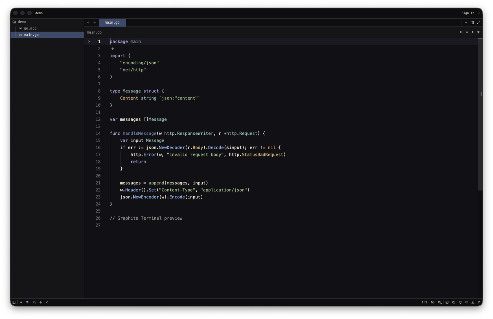

# Graphite Terminal

A dark theme for Zed with graphite panels, warm ivory text, muted blue selections, and a pale blue focus ring. Built-in functions such as Go’s `append`, `len`, and `make` use soft green. Orange marks warnings and salmon marks errors.



## Install

Copy [`themes/graphite-terminal.json`](themes/graphite-terminal.json) into your Zed user themes directory.

- macOS and Linux: `~/.config/zed/themes/`
- Windows: `%APPDATA%/Zed/themes/`

Open **Theme Selector** in Zed’s command palette and choose **Graphite Terminal**. For a source checkout, you can also run **zed: install dev extension** and select the repository directory.

## Typography

Add these settings for the compact monospaced look. You can use `.ZedMono` if Menlo is unavailable.

```json
{
  "ui_font_family": "Menlo",
  "ui_font_size": 13,
  "buffer_font_family": "Menlo",
  "buffer_font_size": 13,
  "terminal": {
    "font_family": "Menlo",
    "font_size": 13
  }
}
```

The theme styles Zed’s existing panels, menus, diagnostics, and terminal. Geometry and animation follow the editor. The iPhone preview panel is a feature of the Zed Studio fork.
